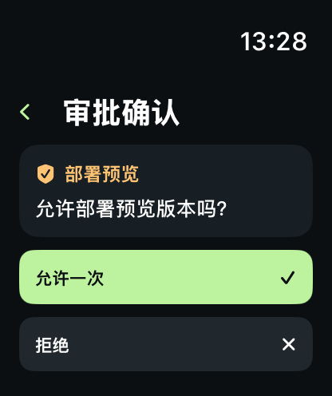

# grokbot-watch

目标是做 Apple Watch 上的 Grok Bot 轻量伴侣，配合官方 Grok Bot iPhone app，在手表上快速回复、处理确认并控制语音对话；这些产品功能尚未接入当前 App。

> 非官方的个人项目，与 xAI 或 Cursor 没有关联，也未获其认可。设计拟采用 Grok Bot 官方客户端的私有、未公开接口，接口随时可能变化或失效，使用也可能不符合服务条款。仅限仓库所有者本人侧载自用，不上架，不分发，不商业化。

## 状态

**产品 MVP 尚未达成。** 已交付纯 Swift 逻辑核心、双端占位 App 和构建结构验证；当前两个 App 仅显示 `GrokBot Watch` 文本，尚不能通过真实 Grok 服务回复、确认或通话。浏览器授权、Keychain、真实 HTTP／WatchConnectivity／Foundation Models 适配器及功能 UI 待开发。

CI 已合入 main，针对 `e0226fe` 的 [main push 运行成功](https://github.com/2mauis/grokbot-watch/actions/runs/44040269389)。单元测试使用 fake／协议注入，模拟器 clean build 与内嵌 plist 检查不代表功能端到端验收。逐项状态见 [功能地图](docs/feature-map.md)，验证分层及版本证据见 [MVP 状态](docs/mvp-status.md)。

## 代表性界面演示

以下历史代表性画面展示收件箱、审批和候选回复的目标体验，仅作演示用途。它们不代表当前入仓的占位 App 已实现这些交互，也不作为功能实测证据。

| 收件箱 | 审批确认 | 快捷回复 |
| :---: | :---: | :---: |
|  |  |  |

当前版本双端模拟器启动为项目报告，未独立核验原始截图；不作为功能交互验收。

## 功能（与 [docs/feature-map.md](docs/feature-map.md) 一致）

以下是第一版（MVP）计划，尚未完成 App 集成和产品验收；F3、F4、F5 仍在 MVP 范围内：

- **F1 确认类问答**：widget 选项、Allow/Deny、简单表单，在手表上一点完成。
- **F2 智能快速回复**：iPhone 根据 Bot 的最新消息生成 2–4 条候选，手表一点即发。
- **F3 自定义常用回复卡片**：在 iPhone 上编辑，在手表上使用。
- **F4 语音输入兜底**：系统听写。
- **F5 语音对话开关**：由 iPhone 跑语音，手表负责开始、结束和静音。手机锁屏时能否从手表发起通话要先验证（S-3）；不行就改为在手机上开始、手表控制。配套 app 被从多任务里划掉后，手表无法把它拉起来，这是已知限制。
- **F8 收件箱**：列出主 Bot 待你处理的问题。
- 基础：B1 iPhone 登录，B2 私有接口客户端，B3 WatchConnectivity 协议（手表持久发件箱，结果保证回传，写操作不自动重放；送达失败时由用户在手表上点"重试"）。

后续：F4+ 录音转写，F6 麦克风智能路由，F7 手表直连降级，F8+ complication 和可操作通知。

## 目标架构

计划由手表负责轻量回复和控制，iPhone 配套 app 负责登录、服务通信和语音，两端走 WatchConnectivity；手表 HTTPS 直连降级属于后续 F7。当前只有纯逻辑核心，真实适配器与 App 接线待开发。详见 [docs/architecture.md](docs/architecture.md)。

## 在 Mac 上构建

用 Xcode 打开 `GrokBotWatch.xcodeproj`。两个 App 的最低系统版本为 iOS 26.0 和 watchOS 26.0。

### 模拟器

App 骨架已在 Xcode 27.2 的 macOS CI 中通过双端 Debug 无签名模拟器 clean build 和内嵌结构核验，见 [CI 证据](docs/ci.md#公开运行证据)。以下为手动构建命令，CI 不启动 UI。

```sh
xcodebuild -project GrokBotWatch.xcodeproj -scheme GrokBotWatch \
  -configuration Debug -destination 'generic/platform=iOS Simulator' CODE_SIGNING_ALLOWED=NO clean build
xcodebuild -project GrokBotWatch.xcodeproj -scheme 'GrokBotWatch Watch' \
  -configuration Debug -destination 'generic/platform=watchOS Simulator' CODE_SIGNING_ALLOWED=NO clean build
```

纯 Swift 核心包的命令是 `swift test --package-path Packages/GrokBotWatchCore`；已有执行证据来自 macOS CI，Linux Swift 尚未验证。现有 CI 使用标准 `xcode-27` 预览 runner，显式选择 Xcode 27.2。范围与故障处理见 [docs/ci.md](docs/ci.md)；真机、签名和真实服务端到端均未验收。

### Personal Team 真机安装

以下为计划操作说明，目前没有可标记为已验收的签名或真机安装证据；设备分发仍按既有部署批准流程执行。

1. 在本机创建 `Config/Secrets.xcconfig`，填入签名团队 ID 和自选的 Bundle ID 前缀。Git 会忽略此文件。

   ```xcconfig
   DEVELOPMENT_TEAM =
   BUNDLE_ID_PREFIX =
   ```

2. 在 Xcode 的 Signing & Capabilities 中，确认两个 target 使用同一个 Personal Team 和自动签名。
3. 先选择 `GrokBotWatch` scheme 安装 iOS App，再选择 `GrokBotWatch Watch` scheme 安装 Watch App。
4. 免费 Personal Team 的描述文件 7 天后过期，届时需重新构建并安装两个 App。详见 [规格 §10](docs/spec.md#10-构建与签名约束负责人-2026-11-16-决定)。

## 文档

- [docs/spec.md](docs/spec.md)：目标、非目标、功能和验收条件
- [docs/feature-map.md](docs/feature-map.md)：功能地图
- [docs/mvp-status.md](docs/mvp-status.md)：当前实现、验证层级、版本证据和剩余事项
- [docs/ci.md](docs/ci.md)：已运行的 CI 范围与历史准备记录
- [docs/architecture.md](docs/architecture.md)：架构、消息协议、麦克风路由、降级
- [docs/design/](docs/design/)：调研和决策归档
- [AGENTS.md](AGENTS.md)、[docs/workflow-v2.md](docs/workflow-v2.md)：开发规则（workflow v2.2）

## 许可

MIT，见 [LICENSE](LICENSE)。第三方参考见 [NOTICE.md](NOTICE.md)。
