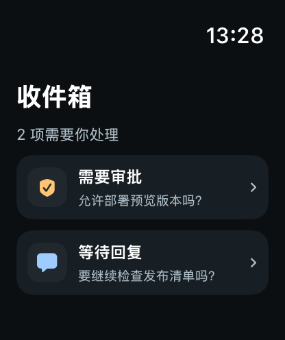
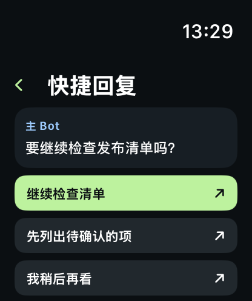

# grokbot-watch

目标是在 Apple Watch 上处理 Grok Bot 消息、回复问题、完成确认，并控制手机上的语音通话。

**现在已做部分底层逻辑，App 仍是文字骨架，还不能连接真实 Grok 回复、确认或通话。** 常用卡片、系统听写和手机麦克风语音尚未实现。

从 [功能表与短路线图](docs/mvp-status.md) 看哪些做了、模拟器实际测过什么、还剩什么；[功能范围](docs/feature-map.md) 列出第一版与以后再做的内容。

> 非官方的个人项目，与 xAI 或 Cursor 没有关联，也未获其认可。设计拟采用 Grok Bot 官方客户端的私有、未公开接口，接口随时可能变化或失效，使用也可能不符合服务条款。仅限仓库所有者本人侧载自用，不上架，不分发，不商业化。

## 项目文档

- [目前能做什么与接下来的路线图](docs/mvp-status.md)
- [第一版功能与后续范围](docs/feature-map.md)
- [完整需求与验收条件](docs/spec.md)

<details>
<summary>历史代表性演示图（不是当前 App 的交互实测）</summary>

以下画面只展示收件箱、审批和候选回复的目标体验。当前入仓的 App 只有文字占位页，不包含这些页面。

| 收件箱 | 审批确认 | 快捷回复 |
| :---: | :---: | :---: |
|  |  |  |

已有项目报告在模拟器启动过双端文字骨架，原始截图未独立核验；不作为功能交互验收。

</details>

<details>
<summary>开发者参考：构建、安装与 CI</summary>

用 Xcode 打开 `GrokBotWatch.xcodeproj`。两个 App 的最低系统版本为 iOS 26.0 和 watchOS 26.0。

### 模拟器

App 骨架已在 Xcode 27.2 的 macOS CI 中通过双端 Debug 无签名模拟器 clean build 和内嵌结构核验，见 [CI 证据](docs/ci.md#公开运行证据)。以下为手动构建命令，CI 不启动 UI。

```sh
xcodebuild -project GrokBotWatch.xcodeproj -scheme GrokBotWatch \
  -configuration Debug -destination 'generic/platform=iOS Simulator' CODE_SIGNING_ALLOWED=NO clean build
xcodebuild -project GrokBotWatch.xcodeproj -scheme 'GrokBotWatch Watch' \
  -configuration Debug -destination 'generic/platform=watchOS Simulator' CODE_SIGNING_ALLOWED=NO clean build
```

纯 Swift 核心包的命令是 `swift test --package-path Packages/GrokBotWatchCore`；已有执行证据来自 macOS CI，Linux Swift 尚未验证。现有 CI 使用标准 `xcode-27` 预览 runner，显式选择 Xcode 27.2。范围与故障处理见 [docs/ci.md](docs/ci.md)；真机、签名和真实服务端到端均未验收。

### Personal Team 真机安装

以下为计划操作说明，目前没有可标记为已验收的签名或真机安装证据；设备分发仍按既有部署批准流程执行。

1. 在本机创建 `Config/Secrets.xcconfig`，填入签名团队 ID 和自选的 Bundle ID 前缀。Git 会忽略此文件。

   ```xcconfig
   DEVELOPMENT_TEAM =
   BUNDLE_ID_PREFIX =
   ```

2. 在 Xcode 的 Signing & Capabilities 中，确认两个 target 使用同一个 Personal Team 和自动签名。
3. 先选择 `GrokBotWatch` scheme 安装 iOS App，再选择 `GrokBotWatch Watch` scheme 安装 Watch App。
4. 免费 Personal Team 的描述文件 7 天后过期，届时需重新构建并安装两个 App。详见 [规格 §10](docs/spec.md#10-构建与签名约束负责人-2026-11-16-决定)。

更多技术说明见 [架构](docs/architecture.md)、[CI 记录](docs/ci.md) 和 [设计归档](docs/design/)；开发规则见 [AGENTS.md](AGENTS.md) 与 [workflow-v2.md](docs/workflow-v2.md)。

</details>

MIT，见 [LICENSE](LICENSE)；第三方参考见 [NOTICE.md](NOTICE.md)。
